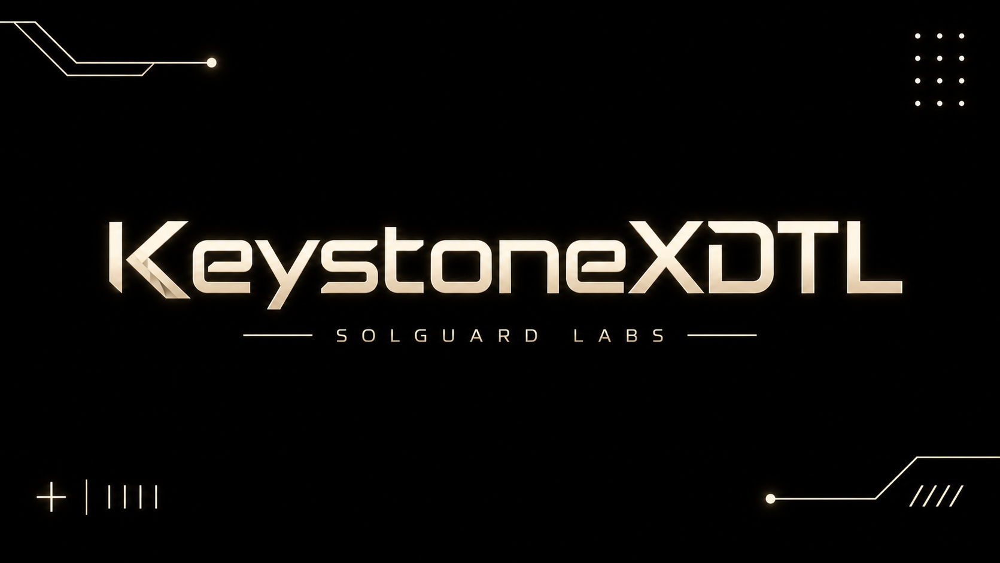
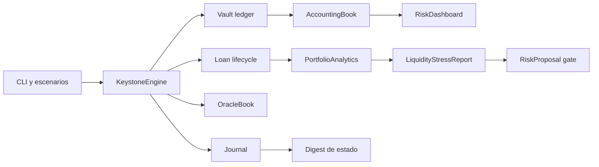
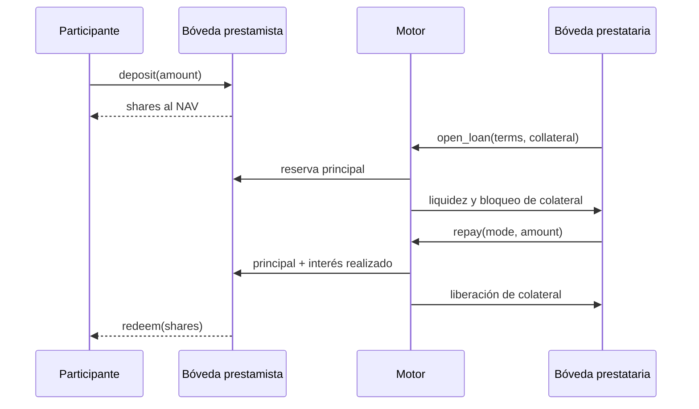
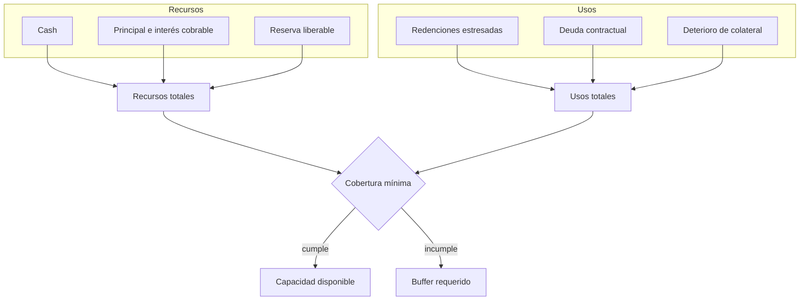
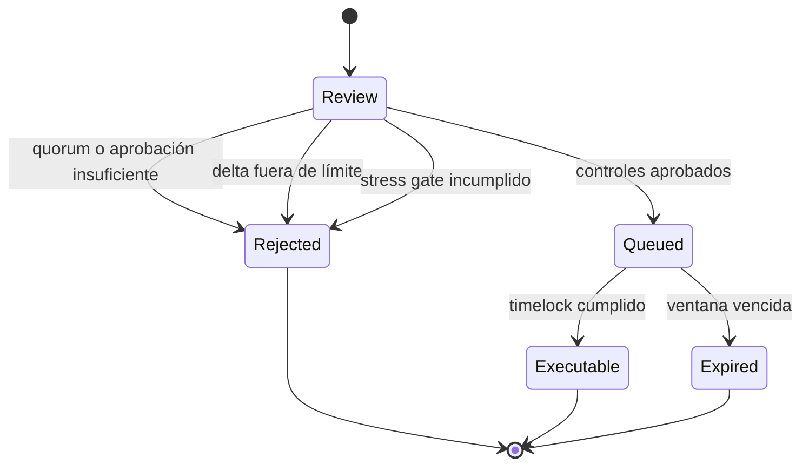

# KeystoneXDTL



KeystoneXDTL es un motor determinista de crédito interno para tesorerías y
bóvedas digitales. Coordina depósitos, préstamos colateralizados, repagos,
liquidaciones, distribución de intereses y controles de liquidez sin depender
de una red externa. La implementación prioriza trazabilidad contable, estados
tipados y resultados reproducibles.

## Capacidades

- Bóvedas de liquidez, prestatarias, híbridas y de tesorería.
- Emisión y quema de participaciones contra el NAV vigente.
- Préstamos internos con calendario, colateral y precio de riesgo.
- Repago programado, anticipado y parcial.
- Default, liquidación por tramos y reconocimiento de pérdidas.
- Libro de eventos con digest encadenado y snapshots serializables.
- Matriz de contraparte, concentración y vencimientos.
- Stress ALM con cascada de recursos y usos de liquidez.
- Propuestas de riesgo sujetas a quorum, timelock y stress previo.
- CLI JSON estable para automatización y reconciliación.

## Arquitectura



`KeystoneEngine` es la única frontera de mutación económica. Los módulos de
contabilidad, cartera, riesgo, ALM y gobernanza consumen snapshots inmutables y
no alteran saldos. Esta separación permite comparar decisiones de control
contra un estado económico concreto.

## Flujo económico



El valor de una participación se obtiene de:

```text
gross_assets = cash + outstanding_principal + expected_interest + realized_interest
liabilities  = debt_principal + debt_interest_due + protocol_fees
nav          = gross_assets - liabilities
share_price  = nav / share_supply
```

Las operaciones usan enteros y puntos básicos. Los redondeos conservadores se
aplican hacia arriba en obligaciones y hacia abajo en recursos.

## Stress de liquidez

El módulo `alm` transforma cada snapshot en una cascada auditable:



Ejemplo Rust:

```rust
use keystone_xdtl::{LiquidityStressReport, StressScenario};

let report = LiquidityStressReport::from_engine(
    &engine,
    StressScenario::severe()?,
)?;

if !report.passes() {
    let required = report.required_buffer()?;
    eprintln!("additional buffer: {}", required.raw());
}
```

La metodología completa y un caso numérico están en
[`docs/modelo-economico.md`](./docs/modelo-economico.md).

## Gobernanza de riesgo

Un cambio de límites no es ejecutable solo porque obtenga votos. Debe superar
cuatro controles acumulativos:



Los parámetros, criterios de relajación y semántica de las propuestas se
detallan en [`docs/gobernanza.md`](./docs/gobernanza.md).

## Inicio rápido

Requisitos:

- Rust 1.96 o superior.
- Node.js 24 o superior.

```bash
cargo run --quiet -- list
cargo run --quiet -- loan
cargo run --quiet -- portfolio
```

Cada escenario devuelve un `ScenarioReport` JSON con operaciones, vaults,
préstamos, eventos, agregados y digest de estado.

Integración como librería:

```rust
use keystone_xdtl::{AssetId, EngineConfig, KeystoneEngine};

let asset = AssetId::native();
let engine = KeystoneEngine::new(EngineConfig::local(asset)?)?;
let snapshot = engine.snapshot()?;
println!("epoch={} vaults={}", snapshot.epoch.raw(), snapshot.vaults.len());
```

## Verificación

```bash
npm ci
npm run test:all
```

La validación completa ejecuta formato Rust, build bloqueado por `Cargo.lock`,
31 pruebas unitarias, Clippy con warnings como error, contrato JavaScript,
escaneo de superficie pública e integridad de release.

En Windows PowerShell:

```powershell
cargo fmt --all -- --check
cargo build --all-targets --locked
cargo test --locked
cargo clippy --all-targets --all-features --locked -- -D warnings
node --test "tests/node/*.test.js"
```

## Documentación

- [Arquitectura y límites](./docs/arquitectura.md)
- [Modelo económico y stress ALM](./docs/modelo-economico.md)
- [Gobernanza de riesgo](./docs/gobernanza.md)
- [Operación y observabilidad](./docs/operacion.md)
- [Integración del CLI](./docs/integracion.md)
- [Política de seguridad](./SECURITY.md)

## Estructura

```text
src/                 Motor, contabilidad, riesgo, ALM y gobernanza
tests/node/          Contratos de escenarios y flujos económicos
tests/helpers/       Ejecutor común del CLI
docs/                Arquitectura y runbooks operativos
scripts/             Controles locales y de release
.github/workflows/   CI e integridad de publicación
```

## Política de cambios

Los cambios económicos deben incluir un ejemplo cuantitativo, pruebas de
límites y evidencia de reconciliación. Consulte `SECURITY.md` antes de reportar
un hallazgo o proponer una modificación sensible.
