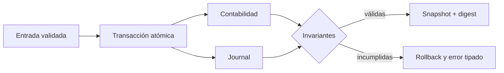
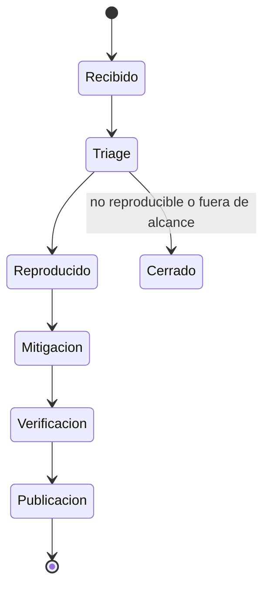

# Política de seguridad

## Versiones mantenidas

| Versión | Estado      |
| ------- | ----------- |
| 1.0.x   | Mantenida   |
| < 1.0   | Sin soporte |

## Modelo de confianza

KeystoneXDTL procesa un libro económico determinista. El operador registra
bóvedas, configura políticas y ejecuta transiciones; las identidades de cuenta
solo autorizan posiciones y participaciones dentro del estado local.

La frontera de confianza incluye:

- integridad de `EngineSnapshot` y del journal encadenado;
- coherencia entre préstamos, bóvedas y libro contable;
- frescura y unidad de los precios del oráculo;
- límites de liquidez, concentración y colateral;
- reproducibilidad del binario a partir del lockfile;
- separación entre cálculo, propuesta y ejecución de gobernanza.

## Invariantes críticas

- La suma de shares por cuenta coincide con el supply de la bóveda.
- El principal abierto coincide entre préstamos y bóvedas prestamistas.
- La deuda de principal e interés coincide con préstamos no terminales.
- Un préstamo nunca usa la misma bóveda como prestamista y prestataria.
- Un estado terminal no conserva principal operativo abierto.
- Un default solo se admite después de vencimiento y gracia.
- Una liquidación solo opera sobre estados admitidos.
- Una bóveda pausada o congelada no acepta mutaciones restringidas.
- El journal y el snapshot producen digests deterministas.
- Las propuestas laxas no cruzan el gate si el stress severo incumple cobertura.

## Controles automatizados

| Control                    | Cobertura                                           |
| -------------------------- | --------------------------------------------------- |
| `cargo fmt --check`        | Forma canónica del código                           |
| `cargo build --locked`     | Resolución reproducible                             |
| `cargo test --locked`      | Aritmética, estados, riesgo, ALM y gobernanza       |
| `cargo clippy -D warnings` | Defectos estáticos y deuda técnica                  |
| Tests Node                 | Contrato JSON y flujos de extremo a extremo         |
| Public surface             | Ausencia de material interno en artefactos públicos |
| Release integrity          | Convergencia de `main`, `production`, tag y versión |

## Áreas de revisión prioritaria

1. Redondeo y orden de actualización entre `loan`, `vault` y `engine`.
2. Composición del NAV y precio de participaciones.
3. Transiciones de repago, default, liquidación y write-off.
4. Límites de concentración y suficiencia de cash.
5. Aplicación de haircuts y cobros bajo stress.
6. Quorum, aprobación, vencimiento y timelock de cambios de riesgo.
7. Serialización canónica, digests y replay de eventos.

## Reporte responsable

No abra un issue público con detalles sensibles. Utilice el canal privado de
advisories disponible en la pestaña **Security** del repositorio. Incluya:

- versión o commit evaluado;
- precondiciones y secuencia mínima reproducible;
- estado esperado y estado observado;
- impacto contable o económico cuantificado;
- prueba reducida que no dependa de servicios externos;
- propuesta de mitigación y regresión sugerida.

Se recomienda cifrar cualquier material que contenga datos operativos. No
incluya secretos, credenciales, claves privadas ni información personal.

## Respuesta

La confirmación inicial no implica aceptación del impacto. La publicación se
realiza cuando existe corrección verificada y una versión mantenida disponible.

## Fuera de alcance

- Ingeniería social, phishing o suplantación.
- Ataques de disponibilidad sin una hipótesis económica reproducible.
- Hallazgos que requieren modificar el binario o el estado fuera de las APIs.
- Problemas exclusivos de herramientas o runtimes sin impacto en KeystoneXDTL.
- Divulgación de dependencias sin demostrar que la ruta afectada es alcanzable.
