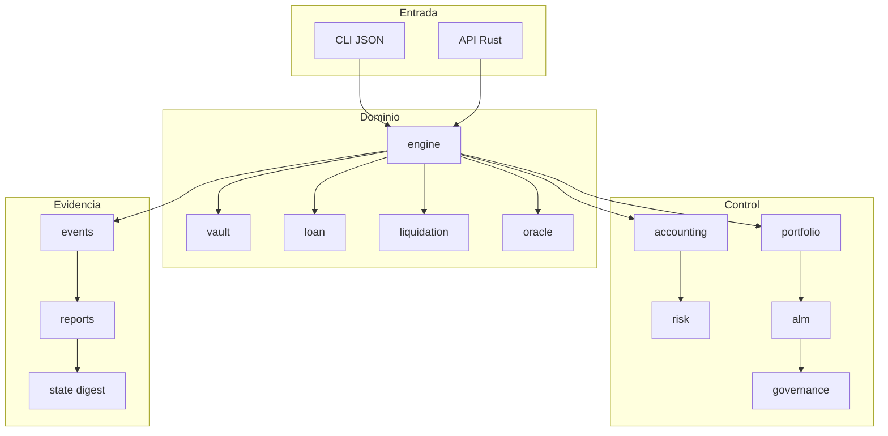

# Arquitectura y límites

## Propósito

KeystoneXDTL separa el estado económico mutable de las vistas de control. El
motor aplica una operación completa o devuelve un error sin publicar un estado
intermedio. Las vistas se reconstruyen desde snapshots para facilitar replay,
comparación y auditoría.

## Capas

## Transacción económica

1. La API resuelve IDs y valida el estado previo.
2. Se extraen temporalmente las entidades implicadas.
3. Se calculan importes con aritmética comprobada.
4. Se aplican débitos y créditos sobre ambas partes.
5. Se restituyen las entidades y se registra el evento.
6. Las invariantes comparan préstamos, bóvedas y agregados.

El paso 3 no usa coma flotante. `Amount`, `Shares`, `Bps` y `Decimal` encapsulan
overflow, underflow, división por cero y dirección del redondeo.

## Identidad y determinismo

Los IDs derivan de componentes canónicos; los préstamos incluyen prestamista,
prestatario, nonce, principal y época inicial. Los digests permiten demostrar
que dos consumidores observaron el mismo snapshot sin compartir estructuras
internas.

## Límites

- No existe acceso de red en el núcleo.
- El oráculo es un libro local y explícito.
- Las vistas analíticas no mutan el motor.
- La gobernanza evalúa propuestas; no ejecuta cambios por sí sola.
- Los scripts de Node consumen exclusivamente la salida pública del CLI.

## Extensión segura

Un módulo nuevo debe aceptar tipos del dominio o snapshots, devolver
`KeystoneResult`, evitar estados globales y aportar pruebas de límites. Una
transición económica nueva debe añadir evento, reconciliación e invariante.
