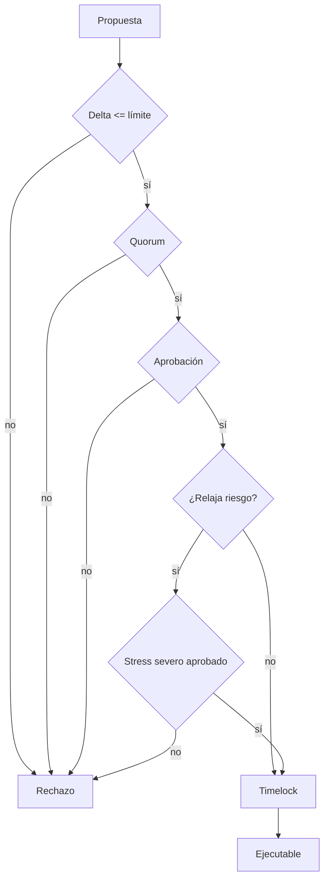

# Gobernanza de riesgo

## Objetivo

El módulo de gobernanza convierte un cambio paramétrico en una decisión
reproducible. No administra identidades ni ejecuta mutaciones: valida que la
propuesta haya reunido apoyo y respete límites económicos.

## Tipos de cambio

- Límite de utilización.
- Límite de deuda por prestatario.
- Suelo de cash.
- Requisito de colateral.
- Factor de reserva.
- Close factor de liquidación.

El sentido de riesgo depende del parámetro. Aumentar utilización o deuda es
relajante; reducir cash, colateral o reserva también lo es.

## Guardrails

| Control             |     Valor |
| ------------------- | --------: |
| Quorum              |      60 % |
| Aprobación decisiva |   66,67 % |
| Timelock            |  2 épocas |
| Delta máximo        | 1.500 bps |
| Cobertura posterior |     110 % |



## Ejemplo

```rust
let proposal = RiskProposal::new(
    42,
    Epoch::new(120),
    20,
    vec![RiskChange {
        kind: ChangeKind::CashFloor,
        current_bps: Bps::strict(1_500)?,
        proposed_bps: Bps::strict(1_800)?,
    }],
    "Increase operating liquidity floor",
)?;
```

`rationale_digest` compromete el texto de justificación sin incorporarlo al
estado de ejecución. Los motivos de rechazo son códigos estables:
`quorum_not_met`, `approval_not_met`, `parameter_delta_exceeded`,
`stress_gate_failed` y `proposal_expired`.

## Operación

La evidencia de una propuesta debe conservar snapshot, escenario de stress,
tally, guardrails y assessment. Si cambia cualquiera de esos elementos, debe
generarse una evaluación nueva; no se reutiliza un resultado anterior.
