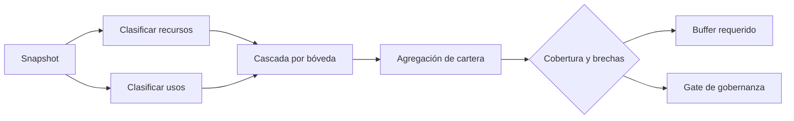

# Modelo económico y stress ALM

## Unidades

`Amount` y `Shares` usan enteros de 64 bits. `Bps` usa 10.000 como 100 %. El
interés lineal se calcula por épocas:

```text
interest = principal × annual_rate_bps × elapsed_epochs
           / 10_000 / epochs_per_year
```

El calendario limita las épocas devengadas al vencimiento. Las obligaciones
que requieren suficiencia usan redondeo al alza; distribuciones y recursos
disponibles usan redondeo a la baja.

## NAV y participación

```text
gross assets = cash + principal receivable + expected interest + realized interest
liabilities  = debt principal + debt interest + protocol fees
NAV          = gross assets - liabilities
price_e12    = NAV × 10^12 / share supply
```

La primera aportación acuña shares uno a uno. Las siguientes se valoran contra
el NAV previo, de modo que no diluyan a holders existentes.

## Cascada ALM

Para una bóveda `v` y escenario `s`:

```text
collectible(v,s) = (principal + expected_interest) × (1 - repayment_delay)
reserve(v,s)     = loss_reserve × reserve_release
resources(v,s)   = cash + collectible + reserve

redemptions(v,s) = NAV × redemption_shock
debt(v)          = debt_principal + debt_interest_due
impairment(v,s)  = locked_collateral × collateral_haircut
uses(v,s)        = redemptions + debt + impairment

coverage(v,s)    = resources / uses
buffer(v,s)      = max(0, uses × minimum_coverage - resources)
```



## Caso numérico

| Concepto            |   Importe |
| ------------------- | --------: |
| Cash                |   600.000 |
| Principal pendiente |   400.000 |
| Interés esperado    |    50.000 |
| NAV                 | 1.050.000 |
| Deuda contractual   |   110.000 |
| Colateral bloqueado |   160.000 |
| Reserva             |    40.000 |

Escenario operativo: 8 % de redenciones, 15 % de retraso, 6 % de haircut y
30 % de liberación de reserva.

```text
collectible = 450.000 × 85 % = 382.500
reserve     = 40.000 × 30 %  = 12.000
resources   = 600.000 + 382.500 + 12.000 = 994.500

redemptions = 1.050.000 × 8 % = 84.000
impairment  = 160.000 × 6 %   = 9.600
uses        = 84.000 + 110.000 + 9.600 = 203.600
coverage    = 488,45 %
```

Este resultado no sustituye las invariantes contables: responde a una pregunta
distinta, la capacidad de absorber salidas bajo hipótesis definidas.

## Concentración

`ExposureMatrix` agrega cada par prestamista-prestatario y calcula principal,
interés, colateral, mora y concentración. Antes de elevar utilización debe
evaluarse simultáneamente cobertura ALM y concentración de la mayor pareja.

## Interpretación

- `passes_floor=false`: la bóveda incumple el mínimo individual.
- `breached_vaults>0`: existe contagio potencial aunque el agregado cubra.
- `shortfall>0`: los recursos no cubren usos nominales.
- `required_buffer>0`: falta capital líquido para alcanzar el umbral objetivo.
