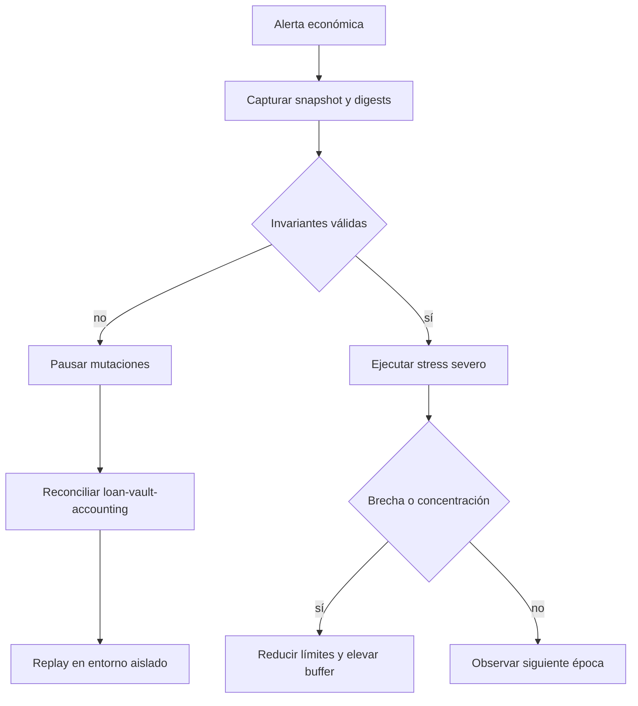

# Operación y observabilidad

## Arranque

```bash
cargo build --release --locked
cargo run --release -- list
```

El proceso no requiere variables de entorno, red ni servicios auxiliares. La
salida estándar es JSON; los errores operativos se emiten por stderr con código
no cero.

## Señales mínimas

| Señal                            | Interpretación                   |
| -------------------------------- | -------------------------------- |
| `journal_digest`                 | Identidad del historial aplicado |
| `state_digest`                   | Identidad económica del snapshot |
| `active_loan_count`              | Crédito con riesgo abierto       |
| `overdue_pair_count`             | Contagio de contraparte en mora  |
| `largest_pair_concentration_bps` | Dependencia de una sola relación |
| `breached_vaults`                | Bóvedas bajo suelo de cobertura  |
| `required_buffer`                | Liquidez adicional del escenario |

## Runbook de degradación



## Reconciliación

1. Conservar salida JSON, versión y commit.
2. Comparar `journal_digest` con el último punto conocido.
3. Ejecutar `verify_invariants` sin aplicar operaciones adicionales.
4. Construir `SystemAccounting`, `PortfolioAnalytics` y `RiskDashboard`.
5. Ejecutar escenarios operativo y severo.
6. Documentar diferencias por vault y préstamo.

## Release

Una publicación válida requiere convergencia del mismo commit en `main`,
`production` y el tag anotado. El workflow de integridad también comprueba la
versión de Cargo, la existencia de documentación y el banner común.
